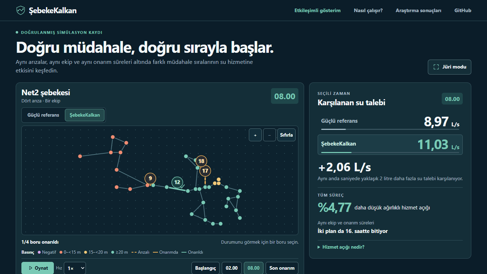

# ŞebekeKalkan

**Su şebekesinde önce hangi arızaya müdahale edilmeli?** ŞebekeKalkan, aynı boruları farklı sırada onarırken müşteriye ulaşan suyu, kritik düşük basıncı ve ekip çizelgesini karşılaştırır. BAÜN III. İnovatif Fikirler Proje Pazarı · 26 Kasım 2026.

Net2_G4_C1 örneğinde ŞebekeKalkan B6, güçlü tekli etki/süre yöntemine göre ağırlıklı hizmet açığını **%4,77** düşürdü. İki plan 16. saatte tamamlandı. Yeni araştırmada seçilen MuR0009_G02_C1 örneğinde aynı ölçüt **%9,06** daha düşük. Bu yüzdeler iki ayrı simülasyon koşuluna aittir. [Tam sonuçlar, eşitlikler ve sınırlar](docs/research/arastirma.html)



## Bir dakikada deneyin

[Kayıtlı web demosunu açın](https://hizmali.github.io/SebekeKalkan/demo/) · [Bilimsel kanıt](https://hizmali.github.io/SebekeKalkan/research/arastirma.html)

1. **Jüri modu** ile şebekeyi ve karşılaştırmayı tam ekrana alın. **02.00**’da dört arızanın başlangıcını izleyin.
2. **08.00**’a dönün ve **Güçlü referans** ile **ŞebekeKalkan** arasında geçin. Aynı adımda 8,97 ve 11,03 L/s karşılanan talep görünür. Tüm süreçteki %4,77’lik hizmet açığı farkı ayrıca gösterilir.
3. **Son onarım** ile 16. saate gidin. Normal görünümde **Vaka kaynağı ve indirmeler** bölümünden zaman serisi CSV ve kanıt JSON dosyalarını alın.

## Windows’ta çalıştırın

Python **3.12 x64** kuruluysa `RUN_LOCAL.cmd` dosyasını çalıştırın. Başlatıcı yalıtılmış ortamı hazırlar, WNTR **1.5.0** dahil bağımlılıkları kilitten kurar ve sağlık kontrolü başarılı olunca tarayıcıyı açar. Boş bir yerel port seçilir. Node geliştirme sırasında kullanılır.

```powershell
.\RUN_LOCAL.cmd
.\RUN_LOCAL.cmd -Python 'C:\Python312\python.exe' -Wheelhouse 'D:\yerel-wheels'
docker compose up --build
```

Yerel gösterimden **Kendi senaryon** bölümünü açın. Net2 veya Skeletonize’da 3–4 boru, 1–2 ekip ve 2–5 saatlik sürelerle çalışın. Üç hazır girdi düzenlenebilir. Yeni iş, fizik denetimlerinden sonra JSON, CSV ve PDF verir. Bir iş sürerken ikinci iş beklemelidir. Web bağlantısı kayıtlı gösterimi açar. Yeni sonuçlar yerel WNTR’de hesaplanır. İnternet kesilirse etkinlik paketindeki **BASLA.html** ve sunum PDF’i kullanılabilir. [Sunum ve kısa demo](docs/competition/juri.md)

## Geliştirme ve doğrulama

```powershell
cd frontend
npm ci
cd ..
./scripts/build-static.ps1
./scripts/smoke-test.ps1 -RunWntr
cd frontend
npm test
```

Yukarıdaki tarayıcı testleri varsayılan yerel portu kullanır. Yeni bir boş port seçildiyse `SE_BASE_URL` ortam değişkenine o adresi verin. Python regresyonlarının tarihsel sonuç denetleyen kısmı, izinli V4.1 kaynak arşivi ve eski SPRINT 01/02 referanslarını kullanır. Bu arşivler araştırma kanıt deposunda saklanır. [Kapsam ve çalıştırma](docs/competition/testler.md)

## Bilimsel kapsam

Yeni ön kayıtlı çalışmada 30 ana koşulun 23’ünde tam birincil kıyas bulundu. Üç kazanım, 20 eşitlik ve sıfır birincil kayıp var. Diğer yedi koşul da sonuç tablosunda yer alır. Şebekeler mühendislik ve sentetik örneklerdir. Saha tasarrufu veya genel algoritmik üstünlük bu verilerle desteklenmiyor. Sistem, basınca bağlı WNTR simülasyonu ve kısıtlı aday araması kullanır. [Karşılaştırma tablosu](docs/research/tum-deneyler.csv) · [Başvuru ve final kapsamı](docs/research/basvuru-ve-final.md)

**Yazarlar** Öğr. Gör. Enise Odabaş (sunucu) ve Öğr. Gör. Mert Hızmalı.

[Mimari](docs/architecture/mimari.md) · [Üçüncü taraf kaynak ve modeller](THIRD_PARTY_NOTICES.md) · [Lisans bildirimi](LICENSE)
